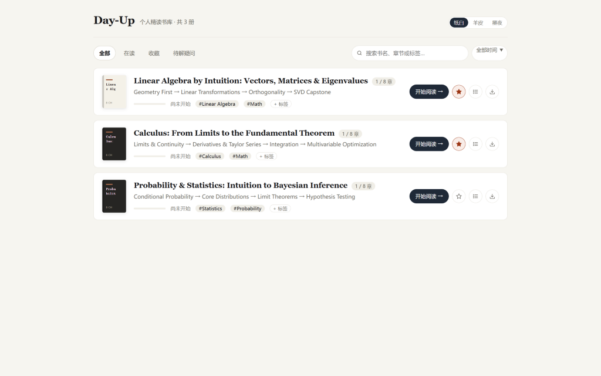
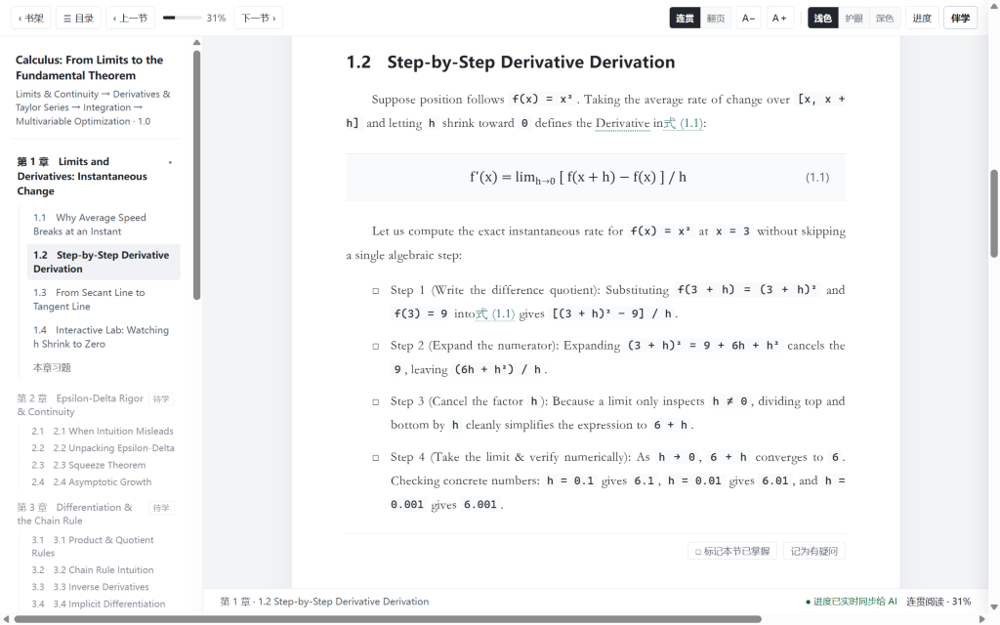
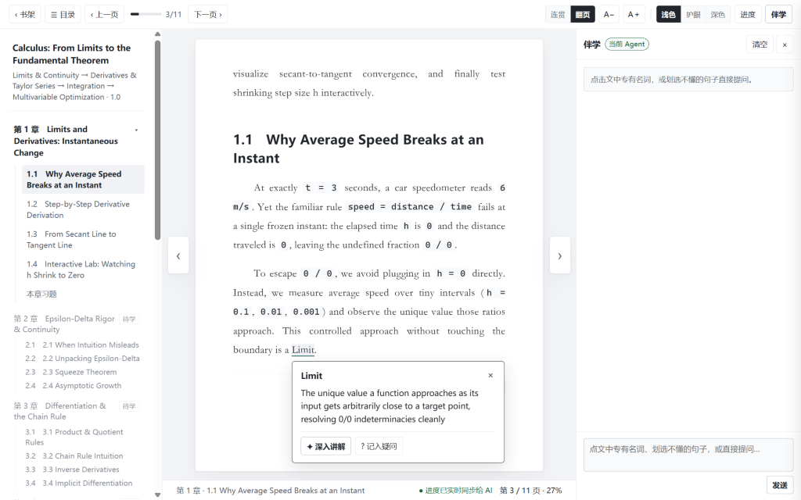
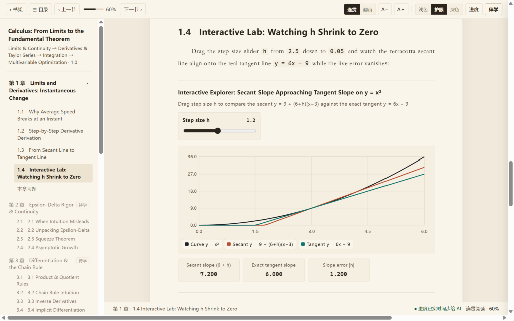

<p align="center">
  
</p>

<p align="center">
  <a href="./README.md">简体中文</a> · <strong>English</strong>
</p>

# day-up

An Agent Skill that turns any topic into a progressive, print-inspired local interactive textbook and organizes every course on a single local bookshelf.

## What it does

- **Book-level syllabus, unlocked chapter by chapter**: Profiles your background first, verifies up-to-date references online, plans a complete syllabus (8–20 chapters), and writes one focused chapter at a time—unlocking the next after you review and take the quiz.
- **Step-by-step reasoning, zero skipped logic**: Builds from concrete situations to concepts, line-by-line derivations, and hands-on artifacts, enforcing a strict per-section concept budget with static/animated diagrams, hover glossaries, and closed-loop exercises.
- **Calm book layout & inline Agent tutoring**: Compiles to a zero-dependency standalone HTML file with continuous scroll / paged reading modes, light/sepia/dark themes, and click-or-highlight follow-up questions routed to your active Agent.
- **Single-port personal library**: Stores all generated books under `~/.day-up/library/` and serves them together on one local bookshelf for searching, tagging, bookmarking, and tracking mastery progress.

## Preview

| Single-Port Personal Library | Print-Style Scroll Reader & Derivations |
| :---: | :---: |
|  |  |
| **Paged Mode · Glossary Popover · Companion Agent** | **Sepia Theme · Interactive Formula Lab** |
|  |  |

## Installation

Install globally in one command with the `skills` CLI (supports Claude Code, Codex, Cursor, Gemini CLI, OpenCode, dsh, zcode, and more):

```bash
npx skills add asekia/day-up -g
```

Or clone directly into your Agent's `skills` directory:

```bash
git clone https://github.com/asekia/day-up.git ~/.claude/skills/day-up
```

> Requires only `Python 3.8+` standard library—no third-party packages needed.

## Usage

After installation, simply ask your Agent what you want to learn (or trigger `/day-up`):

```text
Use day-up to teach me microeconomics from scratch until I can analyze real policy impacts.
```

```text
Use day-up to create a hands-on interactive textbook on Flow Matching and modern image generation.
```

```text
I finished Chapter 1—please address the doubts I marked and then unlock Chapter 2.
```

## License

[MIT](./LICENSE)
